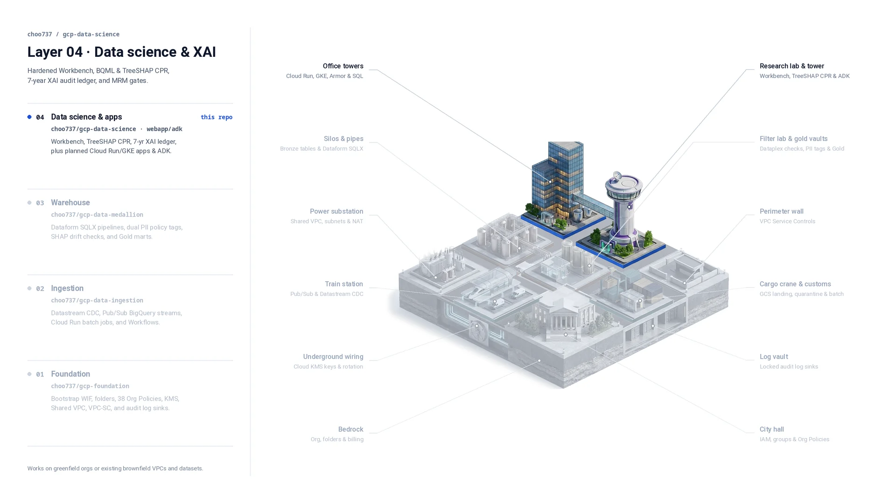
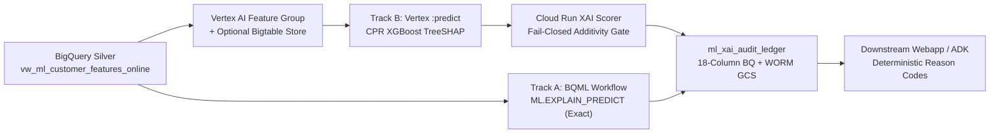

# GCP Data Science

Regulated Vertex AI Feature Store, BigQuery ML, and Custom Prediction Routine TreeSHAP serving across `dev`, `staging`, and `prod`.

This template pairs with [gcp-launchpad](https://github.com/choo737/gcp-launchpad).
It deploys onto [gcp-foundation](https://github.com/choo737/gcp-foundation) landing zones.
It uses Bronze feeds from [gcp-data-ingestion](https://github.com/choo737/gcp-data-ingestion).
It scores Silver features from [gcp-data-medallion](https://github.com/choo737/gcp-data-medallion).

## Template Suite Overview



`gcp-data-science` owns **Layer 04**: feature registries, explainable credit scoring, MRM gates, and immutable decision ledgers.
It enforces exact TreeSHAP additivity and commits every decision synchronously before returning HTTP `200`.

Start in [gcp-launchpad](https://github.com/choo737/gcp-launchpad) to route Greenfield or Brownfield deployments across the template suite.

| Repository | Status | Layer | Responsibility |
| --- | --- | --- | --- |
| [gcp-launchpad](https://github.com/choo737/gcp-launchpad) | Active | Suite Entry Hub | Architecture Router and Brownfield Bridge (`platform-context.json`) |
| [gcp-foundation](https://github.com/choo737/gcp-foundation) | Active | Platform and Governance | Org guardrails, projects, KMS, datasets, and Policy Tags |
| [gcp-data-ingestion](https://github.com/choo737/gcp-data-ingestion) | Active | Ingestion and Runner | Datastream CDC, Pub/Sub streaming, Cloud Run batch ELT |
| [gcp-data-medallion](https://github.com/choo737/gcp-data-medallion) | Active | Warehouse and Quality | Bronze declarations, Silver SCD2, and Gold marts |
| **gcp-data-science** *(this repo)* | Active | Regulated ML and XAI | Feature Store, Track A BQML, Track B CPR TreeSHAP, MRM |
| `gcp-webapp` *(Planned)* | Roadmap | Application Tier | HA web portals consuming deterministic reason codes |
| `gcp-adk-agent` *(Planned)* | Roadmap | AI Agent Tier | Production Google ADK agents on Vertex AI Agent Engine |

## Create Your Private Repository (Do Not Fork Publicly)

- GitHub forces standard forks of public repositories to stay public.
- Click **Use this template** on GitHub or run this command:

```bash
gh repo create acme-corp/gcp-data-science --private --template choo737/gcp-data-science --clone
```

## Architecture & Capabilities

One enterprise stage coordinates batch BQML explainability, private online CPR TreeSHAP serving, and synchronous audit persistence.



1. **Feature Store (`modules/ds/feature-store`)**: Registers zero-copy BigQuery Feature Groups and optional Bigtable online stores.
2. **XAI Serving (`modules/ds/xai-serving-endpoint`)**: Serves private `:predict` endpoints with fail-closed Storage Write API commits.
3. **BQML Pipeline (`modules/ds/bqml-xai-pipeline`)**: Runs scheduled `BOOSTED_TREE_CLASSIFIER` training and exact `ML.EXPLAIN_PREDICT` writes.
4. **MRM Validation Gate (`src/mrm_validation/`)**: Enforces ROC-AUC, KS, `0.80` disparate impact, and TreeSHAP parity before `prod`.

## 6-Step Enterprise Operationalization

Follow [the six-step guide](docs/01-six-step-operationalization.md) before applying infrastructure.
Complete [QUESTIONNAIRE.md](QUESTIONNAIRE.md) to select tracks and thresholds.

1. **Day 0 Private Repo and Gate**: Create a private repo, protect `main`, and add the `model-validator` GitHub environment.
2. **Day 1 Link Landing Zone**: Run `scripts/link-stages.sh` (Greenfield) or generate `00_linked.auto.tfvars.json` (Brownfield).
3. **Day 1 Build Immutable Digests**: Run `build-cpr-and-scorer.yml` to publish `@sha256` digests for CPR and scorer containers.
4. **Day 1 Deploy Baseline (`dev` and `staging`)**: Deploy Track A (`bqml_batch`) in `dev`, then promote both tracks to `staging`.
5. **Day 2 MRM Validation Gate**: Run `evaluate_gate.py`, inspect `model_card.json`, and approve `model-validator` before `prod`.
6. **Day 2 Operate and Audit**: Query `ml_xai_audit_ledger` daily and keep downstream agents locked to deterministic reason codes.

```bash
# Greenfield Day-1 link from gcp-foundation GCS export:
./scripts/link-stages.sh --env prod --from-gcs gs://example-platform-state/foundation-outputs.json stages/enterprise

# Initialize remote state and deploy an environment:
cp stages/enterprise/envs/prod.tfvars.example stages/enterprise/envs/prod.tfvars
make init STAGE=enterprise ENV=prod TF_STATE_BUCKET=example-tf-state-bucket
make plan STAGE=enterprise ENV=prod
make apply STAGE=enterprise ENV=prod
```

## AI Coding Agent Quickstart

Use an AI coding agent with the repository instruction files and workflow skills below.

### Antigravity or OpenAI Codex

```text
Read AGENTS.md, QUESTIONNAIRE.md, and .agents/skills/setup-data-science/SKILL.md.
Check platform-context.json or ask intake questions, create a private repo, link outputs, and deploy stages/enterprise.
```

### Claude Code

```text
Read CLAUDE.md, QUESTIONNAIRE.md, and .agents/skills/setup-data-science/SKILL.md.
Verify gcloud auth, link stages/enterprise, deploy dev or staging, and run audit-xai-compliance before prod.
```

| Skill | File | Purpose |
| --- | --- | --- |
| `setup-data-science` | `.agents/skills/setup-data-science/SKILL.md` | Private repo setup, stage linking, container builds, and Terraform deploy |
| `audit-xai-compliance` | `.agents/skills/audit-xai-compliance/SKILL.md` | Verify TreeSHAP additivity, ledger schema, MRM gate, and zero deprecations |

## CI/CD Workflows

- `.github/workflows/ci.yml`: Runs Terraform formatting, `terraform validate`, and Python unit tests on pushes and PRs.
- `.github/workflows/build-cpr-and-scorer.yml`: Builds `cpr-treeshap` and `xai-scorer` images and pushes `@sha256` digests via WIF.
- `.github/workflows/terraform-deploy.yml`: Promotes `dev` -> `staging` -> `model-validator` gate -> `prod` and exports outputs.

| GitHub Variable | Example Value | Purpose |
| --- | --- | --- |
| `GCP_WIF_PROVIDER` | `projects/<num>/locations/global/workloadIdentityPools/gh/providers/repo` | Workload Identity Pool provider path |
| `GCP_DS_WIF_SA` | `ds-deploy@example-ml-ops-project.iam.gserviceaccount.com` | Preferred Layer 04 service account (falls back to `GCP_WIF_SERVICE_ACCOUNT`) |
| `GCP_TFSTATE_BUCKET` | `example-tf-state-bucket` | GCS bucket holding Terraform state |
| `IAC_OUTPUTS_BUCKET` | `example-platform-state` | GCS bucket sharing upstream and `data-science` outputs |
| `ARTIFACT_REGISTRY_REPOSITORY` | `asia-southeast1-docker.pkg.dev/example-ml-ops-project/ml-containers` | Target Artifact Registry repo for `@sha256` images |

## Repository Layout

- `assets/`: Cloud City Layer 04 visual architecture plate.
- `modules/ds/`: Five-file Terraform modules (`feature-store`, `xai-serving-endpoint`, `bqml-xai-pipeline`).
- `stages/sandbox/`: Single-project stage with GCS backend and committed `.terraform.lock.hcl`.
- `stages/enterprise/`: Locked 35-variable multi-project stage with `envs/{dev,staging,prod}.tfvars.example`.
- `src/cpr_treeshap/`: Exact `OMP_NUM_THREADS=1` XGBoost TreeSHAP Vertex AI CPR predictor.
- `src/scorer_service/`: Fail-closed Cloud Run v2 scorer and BigQuery Storage Write API ledger writer.
- `src/mrm_validation/`: Challenger gate computing ROC-AUC, KS, disparate impact, and `model_card.json`.
- `src/pipelines/`: Vertex AI Pipelines v2 training and registration DAG.
- `sql/`: Parameterized Track A BigQuery ML training and `ML.EXPLAIN_PREDICT` SQL.
- `workflows/`: Cloud Workflows GA `v1` definition for Track A execution.
- `scripts/link-stages.sh`: Local and GCS stage output linker with upstream alias mapping.
- `docs/`: Six-step operationalization and regulated XAI architecture guides.
- `tests/`: Hermetic unit, symmetry, anti-deprecation, and anti-leak test suite.

## Quick Verification

```bash
make fmt-check
make validate
make test
```

## Documentation Index

- [Intake Questionnaire (Greenfield and Brownfield)](QUESTIONNAIRE.md)
- [Six-Step Enterprise Operationalization Guide](docs/01-six-step-operationalization.md)
- [Regulated XAI and MRM Architecture](docs/02-regulated-xai-and-mrm-architecture.md)
- [GCP Launchpad (Suite Hub and Brownfield Bridge)](https://github.com/choo737/gcp-launchpad)
- [GCP Foundation (Upstream Platform and Governance)](https://github.com/choo737/gcp-foundation)
- [GCP Data Ingestion (Datastream, Pub/Sub, and Batch ELT)](https://github.com/choo737/gcp-data-ingestion)
- [GCP Data Medallion (Silver Features and Gold Marts)](https://github.com/choo737/gcp-data-medallion)

## License

Apache License 2.0. See [LICENSE](LICENSE).
