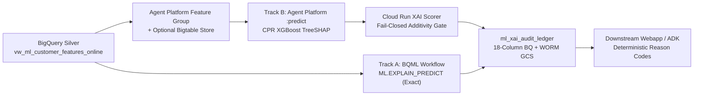

[00 Launchpad](https://github.com/choo737/gcp-launchpad) · [01 Foundation](https://github.com/choo737/gcp-foundation) · [02 Ingestion](https://github.com/choo737/gcp-data-ingestion) · [03 Medallion](https://github.com/choo737/gcp-data-medallion) · **04 Data Science**

# GCP Data Science

Regulated Agent Platform Feature Store, BigQuery ML, and Custom inference routine TreeSHAP serving.
Scores Silver features from [gcp-data-medallion](https://github.com/choo737/gcp-data-medallion) on [gcp-foundation](https://github.com/choo737/gcp-foundation) landing zones.


## Quick Orientation

Run batch BQML and private online TreeSHAP scoring with a fail-closed 7-year WORM audit ledger.

| Consumes From | Deploys | Hands Off To | Standalone Ready? |
| --- | --- | --- | --- |
| `gcp-data-medallion` Silver features (`vw_ml_customer_features_online`) | Agent Platform Feature Store, Track A BQML, Track B TreeSHAP, MRM gate | `ml_xai_audit_ledger`, WORM receipts, and downstream portals or agents | Yes (use `stages/sandbox` or `00_linked.auto.tfvars.json`) |

## Start in 3 Steps

1. **Create your private repository** (GitHub forces standard forks of public repos to stay public):

```bash
gh repo create example-org/gcp-data-science --private --template choo737/gcp-data-science --clone
cd gcp-data-science
gh repo view --json isPrivate --jq '.isPrivate'
```

Confirm `gh repo view` prints `true` before saving `.tfvars` or `00_linked.auto.tfvars.json`.

2. **Run with your AI coding agent** (`Claude Code`, `OpenAI Codex`, `Gemini CLI`, or `Antigravity`):

```text
Read AGENTS.md, QUESTIONNAIRE.md, and .agents/skills/setup-data-science/SKILL.md.
Link upstream outputs, configure stages/enterprise, and run audit-xai-compliance before prod.
```

3. **Verify locally**:

```bash
make help
make fmt-check
make validate
make test
```

## Platform Districts

| Repository | District & Layer | Core Capabilities | Status |
| --- | --- | --- | --- |
| [gcp-launchpad](https://github.com/choo737/gcp-launchpad) | `00` City Planning Hub | Intake Q&A, preflight check, and Brownfield bridge | Active |
| [gcp-foundation](https://github.com/choo737/gcp-foundation) | `01` Governance & Utilities | Folders, 38 Org Policies, Shared VPC, VPC-SC, KMS, and SCC | Active |
| [gcp-data-ingestion](https://github.com/choo737/gcp-data-ingestion) | `02` Entry Ports & Bridges | Pub/Sub + DLQ, Datastream CDC, Cloud Run jobs, and Workflows | Active |
| [gcp-data-medallion](https://github.com/choo737/gcp-data-medallion) | `03` Warehouses & Quality | BigQuery Bronze/Silver/Gold, Dataform, and Knowledge Catalog | Active |
| **gcp-data-science** *(this repo)* | `04` Offices, AI & Homes | Agent Platform, BigQuery ML, TreeSHAP XAI, and WORM ledger | Active |
| `gcp-webapp` *(Planned)* | Hosted App Template | HTTPS Load Balancer, Cloud Armor, Cloud Run, and Cloud SQL | Roadmap |
| `gcp-adk-agent` *(Planned)* | Hosted Agent Template | Google ADK on Agent Runtime or Cloud Run with eval gates | Roadmap |

## Technical Reference

<details open>
<summary><strong>1. Architecture, Mermaid Flow & 2026 Product Naming</strong></summary>

One enterprise stage coordinates batch BQML explainability, private online CPR TreeSHAP serving, and synchronous audit persistence.



- **Agent Platform Feature Store (`modules/ds/feature-store`)**: Registers zero-copy BigQuery Feature Groups and Bigtable online stores.
- **XAI Serving (`modules/ds/xai-serving-endpoint`)**: Serves private `:predict` endpoints with fail-closed Storage Write API commits.
- **BQML Pipeline (`modules/ds/bqml-xai-pipeline`)**: Runs scheduled `BOOSTED_TREE_CLASSIFIER` training and exact `ML.EXPLAIN_PREDICT` writes.
- **7-Yr WORM Ledger**: Persists 18 locked columns to BigQuery and WORM GCS before returning HTTP `200`.
- **MRM Validation Gate (`src/mrm_validation/`)**: Enforces ROC-AUC, KS, `0.80` disparate impact, and TreeSHAP parity before `prod`.
- **2026 AI names**: Uses Agent Platform (formerly Vertex AI) and Agent Runtime (formerly Vertex AI Agent Engine).
- **2026 workflow names**: Uses Workflows (formerly Cloud Workflows) for Track A BQML orchestration.

Read [docs/02-regulated-xai-and-mrm-architecture.md](docs/02-regulated-xai-and-mrm-architecture.md) for the deprecation matrix and TreeSHAP parity contracts.

</details>

<details open>
<summary><strong>2. Prerequisites, Keyless WIF CI/CD & Cost Guardrails</strong></summary>

Three GitHub Actions workflows enforce Terraform validation, signed `@sha256` container builds, and MRM-gated `prod` promotion.

- `.github/workflows/ci.yml`: Runs Terraform formatting, `terraform validate`, and Python unit tests.
- `.github/workflows/build-cpr-and-scorer.yml`: Builds `cpr-treeshap` and `xai-scorer` images and pushes `@sha256` digests.
- `.github/workflows/terraform-deploy.yml`: Promotes `dev` and `uat` through `model-validator` to `prod`.

| GitHub Variable | Example Value | Purpose |
| --- | --- | --- |
| `GCP_WIF_PROVIDER` | `projects/<num>/locations/global/workloadIdentityPools/gh/providers/repo` | Workload Identity Pool provider path |
| `GCP_DS_WIF_SA` | `ds-deploy@example-ml-ops-project.iam.gserviceaccount.com` | Preferred Layer 04 deployer service account |
| `GCP_TFSTATE_BUCKET` | `example-tf-state-bucket` | GCS bucket holding Terraform state |
| `IAC_OUTPUTS_BUCKET` | `example-platform-state` | GCS bucket sharing upstream and `data-science` outputs |
| `ARTIFACT_REGISTRY_REPOSITORY` | `asia-southeast1-docker.pkg.dev/example-ml-ops-project/ml-containers` | Artifact Registry repo for `@sha256` images |

- **Zero-idle Track A baseline**: Set `ds_serving_track = "bqml_batch"` with `enable_online_feature_store = false` for serverless billing.
- **Optional Bigtable online store**: Enabling `feature_online_store_min_nodes = 1` adds always-on node charges (`asia-southeast1` only).
- **Online CPR `:predict` endpoints**: Keep `deploy_cpr_model = false` in `dev` until signed container testing begins.

</details>

<details open>
<summary><strong>3. Repository Layout, Agent Skills & Day-0 to Day-2 Guides</strong></summary>

### Antigravity or OpenAI Codex

```text
Read AGENTS.md, QUESTIONNAIRE.md, and .agents/skills/setup-data-science/SKILL.md.
Check platform-context.json or ask intake questions, create a private repo, link outputs, and deploy stages/enterprise.
```

### Claude Code

```text
Read CLAUDE.md, QUESTIONNAIRE.md, and .agents/skills/setup-data-science/SKILL.md.
Verify gcloud auth, link stages/enterprise, deploy dev or uat, and run audit-xai-compliance before prod.
```

| Skill | File | Purpose |
| --- | --- | --- |
| `setup-data-science` | `.agents/skills/setup-data-science/SKILL.md` | Private repo setup, stage linking, container builds, and Terraform deploy |
| `audit-xai-compliance` | `.agents/skills/audit-xai-compliance/SKILL.md` | Verify TreeSHAP additivity, ledger schema, MRM gate, and zero deprecations |

### Repository Layout

- `modules/ds/` & `stages/`: Three 5-file modules plus `stages/sandbox/` and 35-variable `stages/enterprise/`.
- `src/cpr_treeshap/` & `src/scorer_service/`: `OMP_NUM_THREADS=1` TreeSHAP predictor and Cloud Run v2 scorer.
- `src/mrm_validation/` & `src/pipelines/`: MRM challenger gate (`model_card.json`) and Agent Platform Pipelines v2 DAG.
- `sql/`, `workflows/`, & `scripts/`: Track A BQML `ML.EXPLAIN_PREDICT` SQL, Workflows GA `v1`, and `link-stages.sh`.
- `QUESTIONNAIRE.md`, `CODEOWNERS`, `assets/`, `docs/`, & `tests/`: Intake, reviewers, visual plate, guides, and hermetic tests.

### Day-0 to Day-2 Guides & Sibling Playbooks

- [Intake Questionnaire (Greenfield and Brownfield)](QUESTIONNAIRE.md)
- [Six-Step Enterprise Operationalization Guide](docs/01-six-step-operationalization.md)
- [Regulated XAI and MRM Architecture](docs/02-regulated-xai-and-mrm-architecture.md)
- [GCP Launchpad (Suite Hub and Brownfield Bridge)](https://github.com/choo737/gcp-launchpad)
- [GCP Foundation (Upstream Platform and Governance)](https://github.com/choo737/gcp-foundation)
- [GCP Data Ingestion (Datastream, Pub/Sub, and Batch ELT)](https://github.com/choo737/gcp-data-ingestion)
- [GCP Data Medallion (Silver Features and Gold Marts)](https://github.com/choo737/gcp-data-medallion)
- [GCP Data Science (GitHub Template)](https://github.com/choo737/gcp-data-science)

</details>

## License

Apache License 2.0. See [LICENSE](LICENSE).

**Disclaimer:** This is a personal project. The views, code, and opinions expressed are my own and do not represent my current or past employers.
